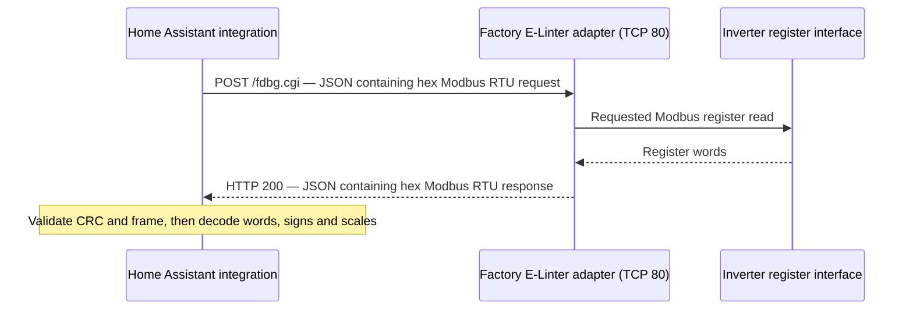

# Sol-Ark Local for Home Assistant

A native Home Assistant integration that reads a **Sol-Ark 18K PV** through its
factory **E-Linter Ethernet/Wi-Fi adapter** over your LAN. It runs directly inside
Home Assistant, with no MQTT broker or cloud credentials.

This is an independent community integration, not an official Sol-Ark product.
Minimum Home Assistant Core: **2026.9.3**.

## Install through HACS

Install this integration as a **custom repository** in HACS. It is not currently
included in HACS's default catalog.

1. In HACS, open the menu → **Custom repositories**.
2. Add `https://github.com/jayburkard/ha-solark-local`, category **Integration**.
3. Find **Sol-Ark Local**, download it, and restart Home Assistant.
4. Stop any other local application polling this inverter before configuring the integration.
5. Open **Settings → Devices & services → Add integration → Sol-Ark Local**.
6. Select **18K PV**, enter the factory adapter's IP address, and submit.

For a manual installation, copy the `custom_components/solark_local` directory
into your Home Assistant `/config/custom_components/` directory, then restart
and follow steps 4–6. A terminal or file editor app can copy the files on HAOS;
the integration itself requires neither an app nor Docker configuration.

## Configuration

| Setting | Location | Default | Meaning |
| --- | --- | --- | --- |
| Inverter model | Setup / Reconfigure | 18K PV | Selects the register profile. This is currently the only supported model. |
| Inverter IP address | Setup / Reconfigure | Required | IP of the factory Ethernet/Wi-Fi adapter, without `http://`, a port, or a path. |
| Modbus address | Collapsed Advanced connection settings | 1 | Only change if the inverter's unit address was changed. Range 1–247. |
| Polling interval | Configure | 15 seconds | Shared update interval for all sensors, from 10 to 300 seconds. |
| Battery installed | Configure | Off | Expose battery measurements and charge/discharge energy estimates only when a battery is connected. |
| PV strings installed | Configure | Off | Expose the three PV inputs and solar energy estimate after PV is connected. |
| Generator installed | Configure | Off | Record hardware presence; generator metering is not supported yet. |
| Grid energy measurement point | Configure | External grid CTs | Choose external CTs or the inverter's internal grid port measurement. |
| Negative grid power means importing | Configure | On | Direction convention for the selected grid measurement. Verify against a known import condition. |

The serial number is read automatically and used for stable entity identity.
Setup verifies the connection and a complete register snapshot. Duplicate
inverters/adapters are rejected. **Reconfigure** changes the IP while requiring
the same inverter serial number, preserving the native entities and their history.
Changing the polling interval reloads the integration automatically.

No username, password, logger registration key, cloud token, MQTT setting, or
separate TCP port setting is necessary for the tested adapter. The protocol uses
HTTP on TCP port 80. Home Assistant must be allowed to reach that port across
any VLAN/firewall boundary.

## How the local HTTP / Modbus connection works

The factory adapter exposes **`POST http://<adapter-ip>:80/fdbg.cgi`**. The client
sends a Modbus RTU read request inside a JSON envelope, and the adapter returns a
Modbus RTU response in the same envelope format. The client chooses which registers
to read in the request; simply opening the endpoint in a browser does not request
a telemetry snapshot.



This is **Modbus RTU encapsulated in HTTP**, rather than a standard Modbus TCP
connection to port 502. The frame includes the RTU CRC; it has no Modbus TCP MBAP
header or transaction ID. Home Assistant communicates with the adapter's LAN IP,
while the unit-address byte inside the frame selects the inverter (default `1`).
The HTTP response carries raw register values, not named sensors or engineering units.

The following behavior was established from a reference packet capture
and direct reads on the supported adapter. It is not a published, universal API
contract for every Sol-Ark/Deye network adapter.

### HTTP request and response

The integration sends these application headers:

```http
POST /fdbg.cgi HTTP/1.1
Host: <adapter-ip>:80
Content-Type: application/octet-stream
Connection: close

{"data":"01 03 00 4F 00 01 B5 DD"}
```

The HTTP library supplies framing headers such as `Content-Length`. Despite the
`application/octet-stream` content type used by the adapter protocol, the body is
**JSON text**. Its `data` value is a string of space-separated hexadecimal bytes;
raw binary Modbus bytes are not placed directly in the HTTP body.

This example requests one register at decimal address **79**, the grid frequency
register in the current 18K profile:

| Request bytes | Meaning |
| --- | --- |
| `01` | Inverter Modbus unit address 1 |
| `03` | Function 03: read holding registers |
| `00 4F` | Starting wire address: `0x004F` = decimal 79 |
| `00 01` | Number of 16-bit registers to read: 1 |
| `B5 DD` | Modbus CRC-16 over the preceding six bytes, low byte first |

Addresses in the code and tables are the addresses placed directly on the wire;
do not add a `40001` reference-number offset. Start address, register count and
register values use high byte first. Only the trailing CRC is low byte first.
The CRC implementation starts at `0xFFFF` and uses the reflected polynomial `0xA001`.

An **illustrative** successful response for a raw value of 6000 is:

```json
{"data":"01 03 02 17 70 B6 50"}
```

| Response bytes | Meaning |
| --- | --- |
| `01 03` | Matching unit address and read function |
| `02` | Two data bytes: one 16-bit register |
| `17 70` | `0x1770` = decimal 6000 |
| `B6 50` | Response CRC-16, low byte first |

The profile applies `6000 × 0.01 = 60.00 Hz`. This response is a worked example,
not a promise that the inverter will return exactly that frequency. Its CRC and
the request CRC above have been checked against the integration's protocol code.

For a multi-register read, the response contains `2 × count` data bytes, with
consecutive words mapped back to `start`, `start + 1`, and so on. It does **not**
echo the starting address. The client associates it with the outstanding HTTP
request and keeps reads sequential. A Modbus exception uses function `0x83` and
an exception code; HTTP 200 alone therefore does not prove the register read succeeded.

### Trying the example manually

Pause other local inverter pollers before testing, and substitute the adapter's
actual address. This command performs only the single frequency read above.

On a POSIX shell:

```sh
curl --max-time 6 --request POST 'http://<adapter-ip>:80/fdbg.cgi' \
  --header 'Content-Type: application/octet-stream' \
  --header 'Connection: close' \
  --data-binary '{"data":"01 03 00 4F 00 01 B5 DD"}'
```

On Windows PowerShell, a body file avoids native-command JSON quoting differences:

```powershell
'{"data":"01 03 00 4F 00 01 B5 DD"}' | Set-Content -Encoding ascii request.json
curl.exe --max-time 6 --request POST "http://<adapter-ip>:80/fdbg.cgi" --header "Content-Type: application/octet-stream" --header "Connection: close" --data-binary "@request.json"
```

The returned hex string still needs CRC/frame validation and register decoding;
`curl` only demonstrates the transport. No login, cookie, logger registration key
or cloud token was required for these reads on the tested firmware. Requests use
plain HTTP on the LAN. The integration constructs only function-03 reads; this
does not establish that the adapter's debug endpoint rejects other function codes.

### What the integration actually reads

Identity is read from registers **3–7**: five words containing ten ASCII bytes of
inverter serial number. The default-unit request is `01 03 00 03 00 05 75 C9`.
The config flow reads identity and validates a complete snapshot before accepting
the device. Coordinator startup and recovery after a failed poll verify identity
again; ordinary successful polls do not continually reread the serial number.

Each normal poll in v0.2.0 reads these six blocks in order:

| Starting wire address | Count | Inclusive range | Current use |
| --- | --- | --- | --- |
| 79 | 21 | 79–99 | Grid frequency; remaining words retained in diagnostics |
| 100 | 20 | 100–119 | PV input voltages and currents; other diagnostic words |
| 120 | 20 | 120–139 | Raw diagnostics; no currently published sensor uses this block |
| 140 | 20 | 140–159 | Grid and inverter voltages |
| 160 | 20 | 160–179 | Internal grid power, external CT power and inverter power |
| 180 | 20 | 180–199 | Battery measurements, PV power and inverter frequency |

The 21-register request limit is a limit of **this client**, chosen around the
observed request sizes; it is not a discovered maximum for the adapter or Modbus.
The six blocks reproduce the recurring reads in the reference capture.
Hardware-presence options currently suppress entities and energy accumulation,
but do **not** trim these wire reads. Faster/selective acquisition has not yet been
implemented.

Every request has a six-second total timeout and is followed by a 300 ms pause,
including the last request in the cycle. Thus the six pauses alone consume
1.8 seconds, in addition to response time. The configured poll interval defaults
to 15 seconds (GUI range 10–300); acquisition takes additional time. All sensor
entities share the completed snapshot, and the blocks represent a short sampling
window rather than one atomic measurement.

The client requires HTTP 200, rejects redirects and bodies larger than 64 KiB,
parses the JSON/hex envelope, then checks CRC, unit address, function, byte count
and total frame length. A failed block rejects the snapshot; entities become
unavailable and polling backs off. Valid responses are unpacked into unsigned
16-bit words before the model profile applies signed interpretation, scale and
offset. For example, raw CT power `65375` becomes signed `-161`, then `-1610 W`
with the 18K grid-power factor of ten. Correct transport alone does not validate
the physical meaning or calibration of every register.

The integration then derives total PV power and, separately, the persistent kWh
estimates described under [Energy dashboard](#energy-dashboard). Those kWh totals
are computed by Home Assistant integration code; they are not energy counters
returned by `/fdbg.cgi` in this implementation.

### Other observed endpoints and source code

The reference capture also contains `GET /getdev.cgi` for adapter metadata and
`POST /invinfo.cgi` with `{"num":0}` for inverter information. Neither call is
required by this integration, and no preliminary session/handshake through them
was needed for direct register reads. Adapter metadata can include a registration
key, so those private responses are not included in this repository.

Implementation references:

- [api.py](custom_components/solark_local/api.py): HTTP envelope, request pacing,
  identity and snapshot acquisition.
- [protocol.py](custom_components/solark_local/protocol.py): CRC, read-frame
  construction, response validation and model-specific register definitions.
- [coordinator.py](custom_components/solark_local/coordinator.py): shared polling,
  recovery, availability and energy checkpointing.
- [energy.py](custom_components/solark_local/energy.py): power-to-energy accumulation.

## Sensors

Up to thirty live measurement entities share one acquisition cycle, with five
additional estimated energy sensors. With PV and battery absent, seventeen
entities are created (fifteen electrical measurements and two grid energy totals).

- Grid and inverter voltages and frequencies.
- Internal and external CT grid power, including per-leg readings.
- Inverter power.
- Battery SOC, voltage, power, current, and temperature.
- Voltage, current, and power for each of three PV inputs, plus total PV power.

Battery power and current are positive while charging. Grid CT power retains
the inverter's sign convention; check import/export polarity against your display
before using it in automations. Numeric sensors have Home Assistant device classes,
units, and measurement state classes. No control entities or write services exist.

Communication is asynchronous. A complete poll is serialized and paced; no sensor
independently requests its registers. A failed snapshot makes the entities
unavailable and polling backs off. Recovery verifies the inverter serial again.
Initial connection failures are retried by Home Assistant. Unloading the
integration removes its polling listeners.

Download diagnostics from the integration menu to obtain the latest raw registers
and decoded readings. The IP address and serial number are redacted. Raw registers
are not added as constantly changing entity attributes or written to separate files.

## Energy dashboard

Energy sensors use `kWh`, device class `energy`, and state class `total_increasing`.
After configuring hardware and grid polarity under the integration's **Configure**
menu, select these sensors in **Settings → Dashboards → Energy**:

| Energy dashboard field | Sol-Ark Local sensor |
| --- | --- |
| Grid consumption | Grid import energy (estimated) |
| Return to grid | Grid export energy (estimated) |
| Solar production | Solar production energy (estimated), with PV enabled |
| Battery energy going in | Battery charge energy (estimated), with battery enabled |
| Battery energy coming out | Battery discharge energy (estimated), with battery enabled |

These are estimates calculated locally from power, using the previous sample's
power over each successful sampling interval (left rectangles). Import and export,
and battery charge and discharge, accumulate separately. They start at zero on
installation and do not import external history or inverter lifetime counters.
Totals are saved through Home Assistant storage before each update is exposed,
and on unload, and are preserved across normal restarts and option reloads.
Include Home Assistant's `.storage` directory in backups. Deleting storage or
restoring an older backup can roll totals back and affect energy statistics.

No energy is invented during restarts, failed polls, or gaps longer than twice the
configured interval plus twelve seconds. Energy during those gaps is **missing**;
these estimates are not billing meters. Polling also misses changes between samples.
Both signs must be checked during commissioning. Changing the grid measurement
point or polarity affects future increments only; it cannot repair past statistics.
External CTs and the inverter grid port can measure different loads.

PV and battery hardware default to **not installed**, including upgrades from 0.1.0.
Enable them in Configure when connected. Previously created entities become
unavailable when disabled; their registry/history and accumulated totals remain,
and their stable IDs return when re-enabled. Raw readings remain in diagnostics.
The inverter can report 100% SOC and nominal battery values with no battery present;
these are not evidence of an installed battery. PV/battery scaling still needs
comparison against connected equipment under load.

The generator option records topology only: **generator power/energy is not yet
supported**. It does not create guessed readings. With a generator connected,
complete energy accounting needs a separately validated generator meter. No direct
load-energy sensor is supplied while the load mapping remains unvalidated.

## Supported hardware and limits

Validated hardware is the factory E-Linter EESE-D200 / AEM2-0013-00 adapter with
firmware 4870124619R and an 18K PV inverter. This does not imply support for every
Sol-Ark or Deye adapter, firmware, or model. Model profiles are separate so future
models can use different mappings rather than being treated as interchangeable.

The adapter transports read-only Modbus RTU function 03 frames via `POST /fdbg.cgi`.
Every response is checked for CRC, unit address, function, byte count, and length.
HTTP redirects are rejected and response size/request duration are bounded.
No inverter settings, adapter settings, firmware, or network rules are changed.

Current limitations:

The [telemetry coverage review](TELEMETRY_REVIEW.md) lists the remaining
sensor gaps and distinguishes software-tested decoding from validation
against connected equipment.

- Nonzero PV scaling still needs a daylight/display comparison.
- Inverter temperature, load power, generator metering, and hardware energy counters
  are not exposed. Energy dashboard totals are software estimates as described above.
- Sequential register blocks cover a short acquisition window, not one atomic instant.
- The integration itself uses only the LAN. The adapter was cloud-connected during
  validation; adapter operation and startup with WAN blocked are still unverified.

## Development and verification

```sh
python -m pip install -r requirements-test.txt
pytest -q
ruff check .
ruff format --check .
```

Use Python 3.14. The test dependency is pinned to Home Assistant **2026.9.3**, and
CI also tests **2026.10.2**. Tests use Home Assistant's actual custom-component
fixtures and an HTTP adapter simulator. The optional hardware test is skipped
unless `SOLARK_LIVE_HOST` is explicitly set; stop other pollers first.

Protocol validation used a reference packet capture: all 128 captured Modbus
requests were reads and their CRCs validated. Register-value comparisons included
the 18K-specific factor of 10 for grid power registers 167–172. Raw captures,
credentials, registration keys, and personal configuration are not included in
this repository.

References: [HA config flows](https://developers.home-assistant.io/docs/config_entries_config_flow_handler/),
[HA coordinators](https://developers.home-assistant.io/docs/integration_fetching_data/),
[HACS requirements](https://www.hacs.xyz/docs/publish/integration/),
[Sol-Ark register reference](https://github.com/pbix/HA-solark-PV/blob/main/custom_components/solark/solark_register_map.py),
[Deye 16kW grid scaling reference](https://github.com/kellerza/sunsynk/blob/main/src/sunsynk/definitions/single_phase_16kw.py).
